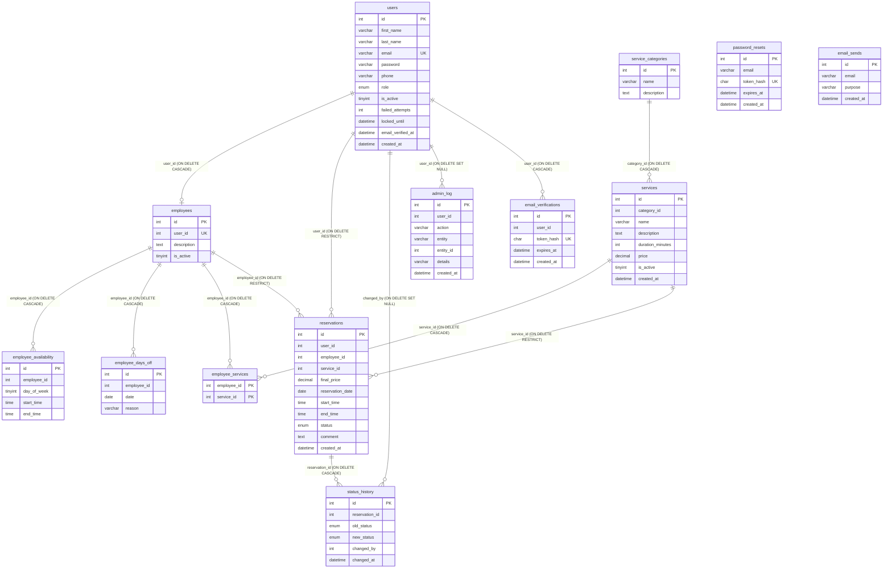

# ERD — OstatniWorekCementu

Aktualny diagram bazy danych (`budowlanka_rezerwacje`, MySQL 8.0, `utf8mb4_unicode_ci`).
Obejmuje **13 tabel domenowych** i odpowiada plikowi `database/database-bez-rekordow.sql`.
Tabela `schema_migrations` to tabela techniczna runnera migracji (`tools/migrate.php`) i nie jest częścią modelu domenowego.

Diagram w formacie Mermaid renderuje się bezpośrednio na GitHubie. Wersją
archiwalną z etapu 1 jest `ERD.jpg` (7 tabel) — nie jest już aktualna.

## Klucze i indeksy

| Tabela | Klucz / indeks | Kolumny | Uwagi |
| --- | --- | --- | --- |
| `users` | `PRIMARY` | `id` | AUTO_INCREMENT |
| `users` | `email` | `email` | UNIQUE |
| `employees` | `PRIMARY` | `id` | AUTO_INCREMENT |
| `employees` | `user_id` | `user_id` | UNIQUE, FK → `users.id` (CASCADE) |
| `employee_availability` | `uq_employee_day` | `employee_id`, `day_of_week` | UNIQUE — jedno okno na dzień |
| `employee_days_off` | `uq_employee_date` | `employee_id`, `date` | UNIQUE — jeden powód na dzień |
| `employee_services` | `PRIMARY` | `employee_id`, `service_id` | klucz złożony (N:M) |
| `services` | `category_id` | `category_id` | FK → `service_categories.id` (CASCADE) |
| `reservations` | `uq_employee_slot` | `employee_id`, `reservation_date`, `start_time` | UNIQUE — brak dwóch rezerwacji w tym samym slocie |
| `status_history` | `reservation_id` | `reservation_id` | FK → `reservations.id` (CASCADE) |
| `status_history` | `changed_by` | `changed_by` | FK → `users.id` (SET NULL) |
| `admin_log` | `entity` | `entity`, `entity_id` | indeks złożony |
| `admin_log` | `user_id` | `user_id` | FK → `users.id` (SET NULL) |
| `password_resets` | `token_hash` | `token_hash` | UNIQUE (przechowywany jest tylko hash SHA-256) |
| `email_verifications` | `token_hash` | `token_hash` | UNIQUE, FK → `users.id` (CASCADE) |
| `email_sends` | `email_purpose_created` | `email`, `purpose`, `created_at` | indeks pomocniczy; w wymaganiach etapu 3 nazwany `uq_email_purpose_created` |

## Relacje i zachowanie `ON DELETE`

- `users` → `employees`: **CASCADE** — usunięcie konta usuwa profil pracownika.
- `users` → `reservations`: **RESTRICT** — nie można usunąć klienta z rezerwacjami.
- `users` → `status_history` / `admin_log`: **SET NULL** — historia zostaje, autor zmiany staje się „systemem”.
- `users` → `email_verifications`: **CASCADE** — tokeny giną razem z kontem.
- `service_categories` → `services`: **CASCADE**.
- `employees` → `employee_availability`, `employee_days_off`, `employee_services`: **CASCADE**.
- `employees` → `reservations`: **RESTRICT** — nie można usunąć pracownika z rezerwacjami.
- `services` → `employee_services`: **CASCADE**.
- `services` → `reservations`: **RESTRICT** — nie można usunąć usługi z rezerwacjami.
- `reservations` → `status_history`: **CASCADE** — historia znika razem z rezerwacją.

`password_resets` i `email_sends` nie mają kluczy obcych — są powiązane z kontem
wyłącznie przez adres e-mail, celowo bez `FK`, żeby nie blokować usuwania kont.
