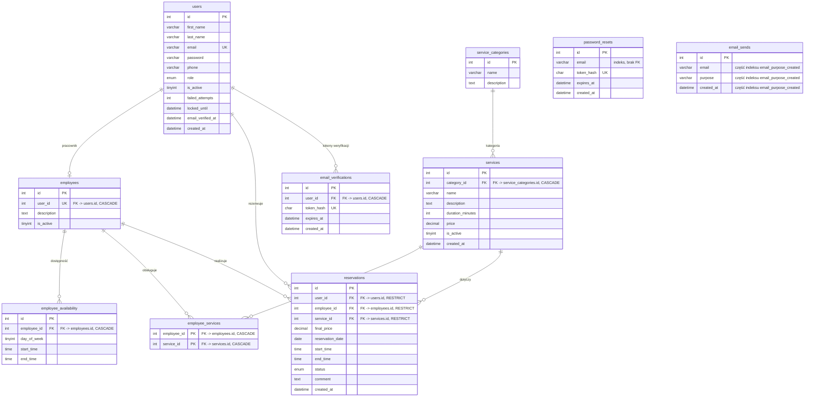

# ERD — OstatniWorekCementu

Diagram bazy danych w składni [Mermaid](https://mermaid.js.org/syntax/entityRelationshipDiagram.html)
(GitHub renderuje go natywnie). Źródłem prawdy jest `database/database-bez-rekordow.sql` —
przy każdej zmianie schematu zaktualizuj ten plik i `database.sql`.

Starszy plik `docs/ERD.jpg` (7 tabel, wrzesień 2026) jest archiwalny i nie odpowiada
obecnemu schematowi (10 tabel).

## Klucze i ograniczenia spoza diagramu

* `employee_availability` — unikalny `uq_employee_day (employee_id, day_of_week)`.
* `reservations` — unikalny `uq_employee_slot (employee_id, reservation_date, start_time)`
  (blokuje podwójną rezerwację tego samego terminu).
* `password_resets` i `email_sends` nie mają kluczy obcych — powiązanie z kontem odbywa się
  po adresie e-mail (`password_resets.email`, `email_sends.email`).
* `email_sends` — indeks `email_purpose_created (email, purpose, created_at)`, po którym działają
  limity wysyłek (cooldown 60 s, maks. 3/godzinę) i retencja 24 h.
